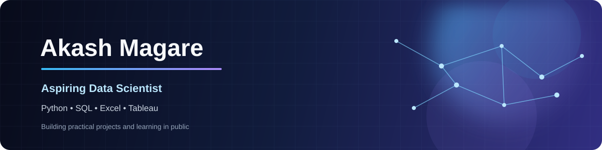

 

  

## 👋 A little about me

I’m Akash, and I’m building my foundation in data science by turning small ideas into working projects. I enjoy the part where messy information becomes a useful report, dashboard, or tool that someone can actually use.

Right now I’m spending most of my time practising **Python, SQL, Excel, and Tableau**. I’m learning by building, testing what I make, and improving each project as I go.

## 🚀 Selected projects

<table>
  <tr>
    <td width="50%" valign="top">
      <h3><a href="https://github.com/AkashMagare/Telegram-Coupon-Bot">🎟️ Telegram Coupon Bot</a></h3>
      
A Telegram bot for searching and sharing coupon offers. It includes SQLite storage, expiry handling, admin commands, inline buttons, pagination, and a demo catalogue of major platforms.

      
<strong>Python · Telegram Bot API · SQLite · JSON</strong>

    </td>
    <td width="50%" valign="top">
      <h3><a href="https://github.com/AkashMagare/Python-Fundamentals-Showcase">💰 Python Fundamentals Showcase</a></h3>
      
A command-line expense tracker I built to practise Python fundamentals. It supports JSON storage, filters, summaries, CSV export, input validation, and automated tests.

      
<strong>Python · argparse · JSON · CSV · unittest</strong>

    </td>
  </tr>
</table>

## 🧰 Tools I use

  

  
  
  

| Area | Current focus |
| --- | --- |
| Programming | Python fundamentals, clean code, testing |
| Data work | SQL, data cleaning, summaries, reporting |
| Visualization | Excel dashboards and Tableau |
| Tools | Git, GitHub, Jupyter, SQLite |

## 📌 What I’m working on next

- Writing cleaner Python and adding tests to each project
- Improving my data cleaning, analysis, and dashboard design
- Learning machine learning through small, understandable examples
- Building projects that show the full path from raw data to a useful result

## 📊 GitHub at a glance

  

## 🤝 Let’s connect

If you would like to discuss a project, learning opportunity, or entry-level data role, feel free to connect with me on [LinkedIn](https://www.linkedin.com/in/akash-magare-466647435/) or [send me an email](mailto:akashmagare1997@gmail.com).

   
  Thanks for stopping by — I’m learning, building, and sharing as I go.

